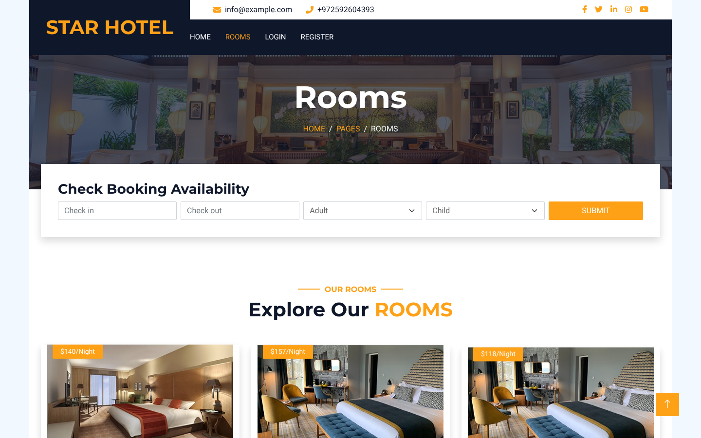
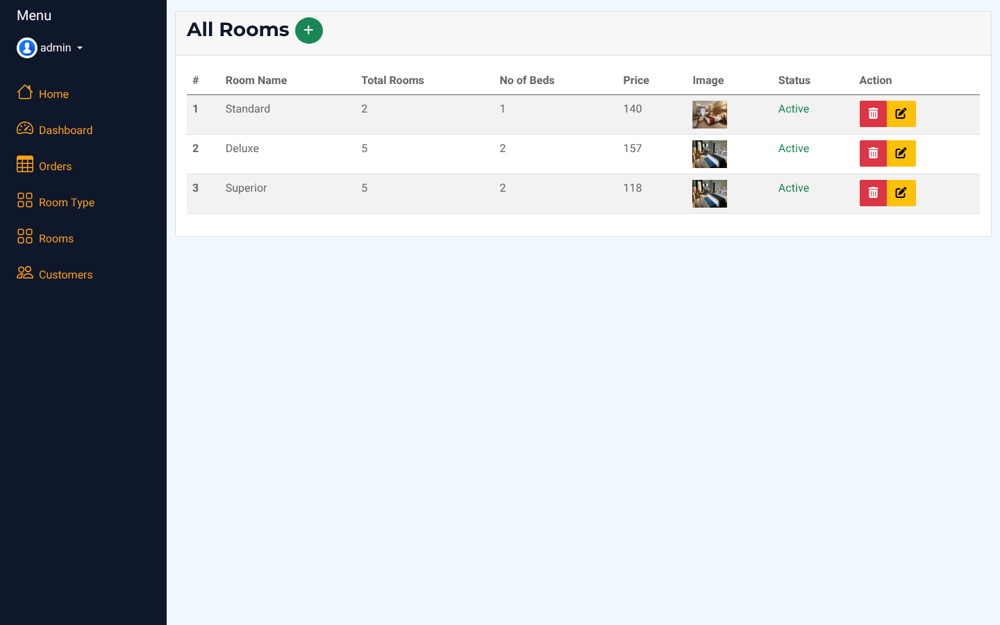

# 🏨 Hotel Booking Platform  
Manage hotel rooms, bookings, and users with a full admin panel.

# 💼 Laravel-Based Room Reservation System  
Browse available rooms and reserve based on check-in/check-out dates.

---

## 🛠 Tech Stack

- Laravel 10
- Eloquent ORM
- Blade Templates
- Database Migration & Seeding
- Authentication

---

## ✨ Features

### 👤 User Side
- User authentication & profile update
- Browse available rooms by check-in/check-out dates
- "My Bookings" section for tracking reservations
- Real-time validation of user inputs

### 🛠 Admin Side
- Secure admin login
- Admin dashboard with full room CRUD (create, update, delete)
- Set room visibility (visible/hidden)
- View and manage all bookings

---

## 🖼 Screenshots

Captured from the running application with the seeded demo data.

**Home**


| Rooms and availability search | Admin: rooms |
|---|---|
|  |  |

---

## 📦 Installation Guide

1. **Clone the repository**
   ```bash
   git clone https://github.com/MohammedAbd20/hotel_Management.git
   ```

2. **Navigate to the project directory**
   ```bash
   cd hotel_Management
   ```

3. **Copy the example environment file**
   ```bash
   cp .env.example .env
   ```

4. **Edit `.env` and set your database credentials**

5. **Install PHP dependencies**
   ```bash
   composer install
   ```

6. **Generate application key**
   ```bash
   php artisan key:generate
   ```

7. **Run migrations and seed the database**
   ```bash
   php artisan migrate --seed
   ```

8. **Start the local development server**
   ```bash
   php artisan serve
   ```

Now visit `http://127.0.0.1:8000` to explore the system.

---

## 👥 Default Login Credentials

### User Account
- **Email:** user@gmail.com  
- **Password:** Password@1

### Admin Account
- **Email:** admin@gmail.com  
- **Password:** Password@1

> ⚠️ Use only for testing purposes. Change credentials in production.

---

## 📧 Contact

- Email: [info@example.com](mailto:info@example.com)  
- WhatsApp: [Click to Chat](https://wa.me/972592604393)

---

## 🙏 Credits

Based on [ramezcode1/hotelManagement](https://github.com/ramezcode1/hotelManagement). The original design and idea belong to its author.
